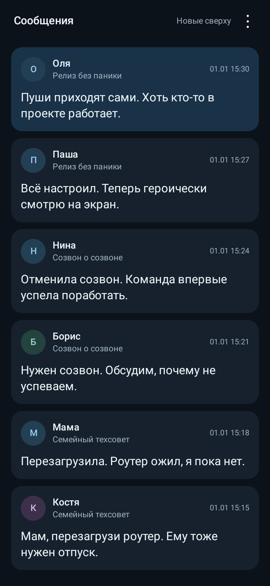
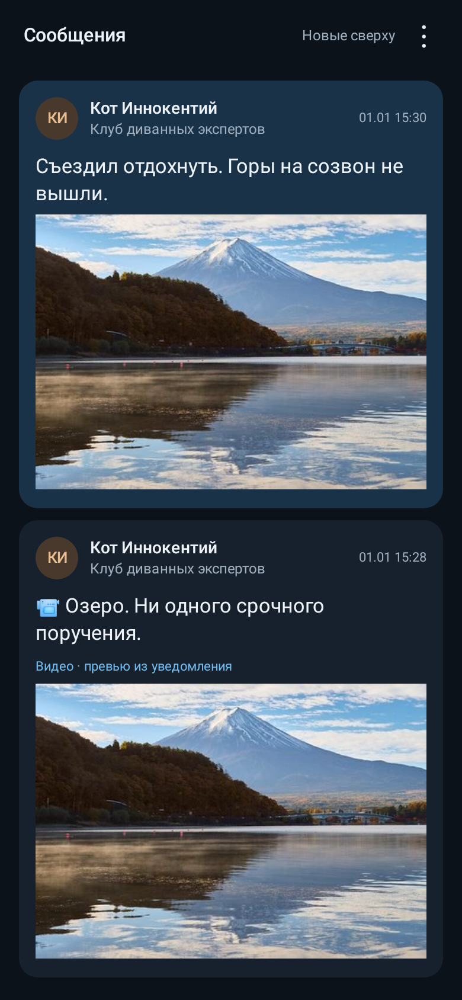
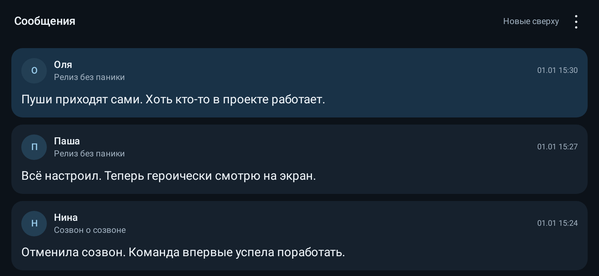
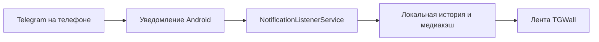

# TGWall

**Панель уведомлений Telegram для отдельного Android-экрана.**

Оставьте приложение открытым — новые сообщения будут появляться автоматически. Тёмная лента, крупный текст, фото из уведомлений и одна колонка с понятной хронологией. Подходит, чтобы превратить запасной телефон в постоянно включённую панель оповещений.

[Скачать APK 1.2.3](https://github.com/jimmorisedu-boop/TGWall/releases/download/v1.2.3/TelegramWall-1.2.3-debug.apk) · [Релизы](https://github.com/jimmorisedu-boop/TGWall/releases) · [Приватность](PRIVACY.md) · [История изменений](CHANGELOG.md)

| Параметр | Значение |
| --- | --- |
| Android | 7.0 и новее, minSdk 24 |
| Версия | 1.2.3 |
| Интерфейс | Нативный Android, Java |
| Источник | Системные уведомления Telegram, Telegram Beta и Telegram X |
| Отдельный вход в TGWall | Не нужен |
| Сетевое разрешение приложения | Отсутствует |
| История | Последние 100 карточек на устройстве |

## VPN и вход в Telegram

**В саму TGWall входить не нужно. На этом же телефоне должен быть установлен Telegram с уже выполненным входом.** Подойдут также поддерживаемые Telegram Beta или Telegram X.

Для работы нужны три вещи:

1. Авторизованный клиент Telegram на телефоне-панели.
2. Включённые уведомления Telegram с показом текста сообщений.
3. Доступ TGWall к уведомлениям Android.

**Без VPN сообщения отображаются, если Telegram получает push с их содержимым и публикует уведомления Android.** В такой ситуации открывать сам Telegram для каждого сообщения не требуется. TGWall не требует собственного VPN, но не обеспечивает доставку сообщений вместо Telegram: если уведомление не дошло до Android, панель самостоятельно его получить не сможет.

## Как выглядит

**Все имена, чаты и сообщения на скриншотах вымышлены.** Сарказм тестовый, рабочие созвоны тоже. Снимки получены из настоящих Android View на тестовых данных. Личная переписка и снимки с пользовательских телефонов не использовались. [Как воспроизвести снимки](docs/SCREENSHOTS.md).

<p>
  
  
</p>

В альбомной ориентации сохраняется одна колонка: новые сообщения сверху, старые ниже.



## Что умеет

- Автоматически показывает текст, отправителя, название чата и время из системного уведомления.
- Разбирает несколько сообщений в `MessagingStyle` на отдельные карточки.
- Обрабатывает доступные текстовые строки личных сводок Telegram X вместо одной общей карточки со счётчиком.
- Показывает доступные фото и видеопревью внутри ленты, без открытия Telegram.
- Если в уведомлении передан настоящий видеофайл, запускает его автоматически, без звука и по кругу. Одновременно воспроизводится один видимый ролик.
- При новом сообщении возвращает ленту к началу.
- Поддерживает все четыре положения телефона, включая перевёрнутый портрет на 180°. Используется `fullSensor`: панель ориентируется по датчику даже при системной блокировке автоповорота.
- Переиспользует видимые карточки, читает историю в фоне и обрабатывает поворот без пересоздания экрана.
- Скрывает системные панели и по умолчанию не даёт экрану погаснуть. Этот режим можно отключить в меню.
- Хранит историю и копии доступных вложений локально. Размер одного входящего файла ограничен 24 MiB, общий медиакэш — 96 MiB.

## Как это работает



TGWall не является клиентом Telegram и не подключается к Telegram API. На телефоне должен быть установлен и авторизован поддерживаемый клиент Telegram. Панель получает только то, что этот клиент включил в системное уведомление.

| Клиент | Пакет Android |
| --- | --- |
| Telegram | `org.telegram.messenger` |
| Telegram Beta | `org.telegram.messenger.beta` |
| Telegram X | `org.thunderdog.challegram` |

## Установка

1. Скачайте APK из [релиза 1.2.3](https://github.com/jimmorisedu-boop/TGWall/releases/tag/v1.2.3) и установите его. Если Android попросит, разрешите установку из выбранного источника.
2. Убедитесь, что Telegram на этом телефоне авторизован, а уведомления и показ текста сообщений включены.
3. Откройте **Telegram Wall**. В пустой ленте нажмите **«Разрешить доступ к уведомлениям»** и включите доступ для приложения в настройках Android.
4. Вернитесь в панель и оставьте её открытой.
5. Для проверки отправьте сообщение с другого аккаунта в чат получателя. Telegram на телефоне-панели открывать не требуется.

Меню **⋮** в верхней панели позволяет открыть настройки доступа, переключить режим **«экран не гаснет»** и очистить историю с подтверждением. Меню также доступно долгим нажатием на карточку.

Готовый APK — отладочная сборка, подписанная отладочным ключом. Обновление поверх предыдущих опубликованных сборок с той же подписью сохраняет данные. Если собирать приложение самостоятельно с другим ключом, Android не позволит установить его поверх сборки с прежней подписью.

## Фото и видео: реальные возможности

| Что Telegram передал Android | Что покажет TGWall |
| --- | --- |
| Текст | Карточку сообщения |
| Фото в `MessagingStyle` или `BigPicture` | Изображение внутри карточки |
| Картинку-превью видео | Картинку с подписью о видеопревью |
| Доступный файл с MIME `video/*` | Автоматическое воспроизведение без звука |
| Только текст «Фото» или «Видео» | Текст и статус отсутствующего вложения |
| Скрытое содержимое | Только доступную часть уведомления |

Полноценный ролик в чате не означает, что Telegram вложил его файл в уведомление. В обычных уведомлениях официального клиента полное видео, как правило, недоступно. Панель не скачивает недостающие файлы по сети, не открывает чаты и не подменяет вложение аватаром отправителя.

Изображения копируются в приватный каталог приложения, пока доступен URI из уведомления. Если файл уже недоступен, показывается статус. Наличие фото зависит также от настроек предпросмотра и автозагрузки в самом Telegram.

## Если часть сообщений не появляется

Сначала проверьте, есть ли содержательное уведомление Telegram в шторке Android. Если Telegram не опубликовал уведомление, панель не сможет получить сообщение.

- Проверьте настройки конкретного чата, уведомления личных сообщений и показ текста в Telegram.
- Проверьте системный доступ TGWall к уведомлениям и ограничения фоновой работы Telegram.
- Убедитесь, что этот диалог не открыт на другом устройстве: активность других сессий может влиять на уведомления и отметку прочтения.
- Если сам Telegram показывает «Соединение…», проверьте его подключение. TGWall не восстанавливает транспорт Telegram.

**Может ли панель получать сообщения без VPN?** Да, если Telegram получает push и передаёт его содержимое в уведомление Android. Для самой панели VPN не нужен. Но наличие push-канала не гарантирует получение всех сообщений и медиа: это зависит от Telegram, сети и настроек телефона.

**Отмечает ли просмотр в панели сообщения прочитанными?** TGWall не вызывает действия «прочитано», не открывает Telegram и не отправляет запросы Telegram API. Отметка прочтения может измениться из-за другого открытого клиента.

**Почему у времени бывает знак `≈`?** В некоторых сводках Telegram X доступны текстовые строки без времени каждого сообщения. В таком случае показано приблизительное время обновления сводки. Если позже поступит обычное уведомление с точными метаданными, соответствующий предпросмотр заменяется.

## Приватность

В манифесте нет разрешения `INTERNET`. Нет собственного сервера, телеметрии и отдельной авторизации в панели. История и медиакэш сохраняются в каталоге приложения на телефоне; очистка ленты удаляет их. Панель обрабатывает только три перечисленных пакета Telegram.

Системное разрешение на чтение уведомлений само по себе широкое: Android выдаёт его приложению целиком. Ограничение источников до Telegram реализовано в коде. [Подробнее о данных и удалении](PRIVACY.md).

## Сборка из исходников

Требуются **JDK 17 или новее**, Android SDK Platform **36** и Android SDK Build Tools, выбранные плагином сборки. Проект использует Android Gradle Plugin **8.13.0** и Gradle Wrapper **8.14.3** с проверкой SHA-256 дистрибутива. Локальная проверка выполнялась на JDK 21.

1. Клонируйте репозиторий и откройте его в Android Studio.
2. Установите необходимые компоненты SDK через SDK Manager.
3. Для командной строки задайте `ANDROID_HOME` или укажите SDK в локальном `local.properties`, например `sdk.dir=/path/to/Android/Sdk`. Этот файл не публикуется.
4. Соберите приложение:

```powershell
# Windows
.\gradlew.bat assembleDebug
```

```sh
# macOS / Linux
./gradlew assembleDebug
```

APK появится в `app/build/outputs/apk/debug/app-debug.apk`. При первом запуске нужны сеть для скачивания Gradle и зависимостей и свободное место для Android SDK.

## Проверки и структура

```powershell
.\gradlew.bat testDebugUnitTest lintDebug assembleDebug
```

Для версии 1.2.3 прошли **49 тестов**, Lint завершился без ошибок, подпись и выравнивание APK проверены. Тесты проверяют разбор уведомлений и сводок, объединение истории, медиакэш, управление плеером, настройки и компоновку экрана. Это не означает гарантированную доставку push на любой прошивке. [Проверки и ограничения](docs/TESTING.md).

```text
app/src/main/java/ru/telegramwall/app/
  MainActivity.java                  Лента, меню и жизненный цикл экрана
  TelegramNotificationListener.java  Приём и разбор уведомлений
  FeedItem.java                      Модель карточки
  FeedStore.java                     История, сортировка и объединение
  MediaCache.java                    Локальные копии вложений
  PanelMediaView.java                Изображения и воспроизведение видео
app/src/test/                        Тесты и искусственные медиафикстуры
docs/images/                         Публичные скриншоты на тестовых данных
```

TGWall — независимый проект, не связанный с командой Telegram. Сведения о сторонних материалах и инструментах находятся в [THIRD_PARTY_NOTICES.md](THIRD_PARTY_NOTICES.md).
